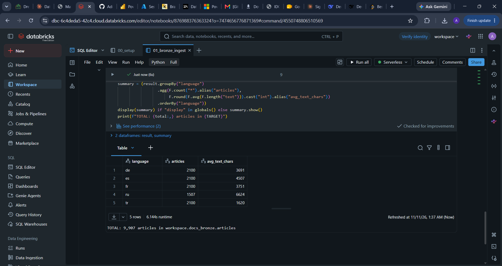
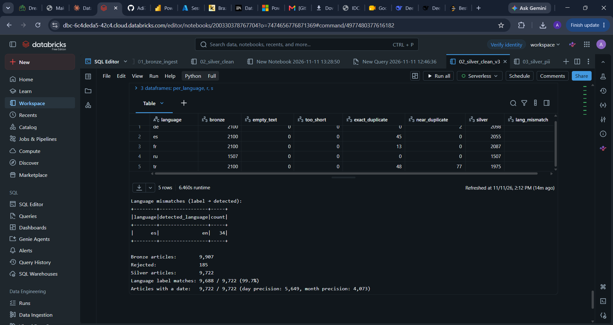
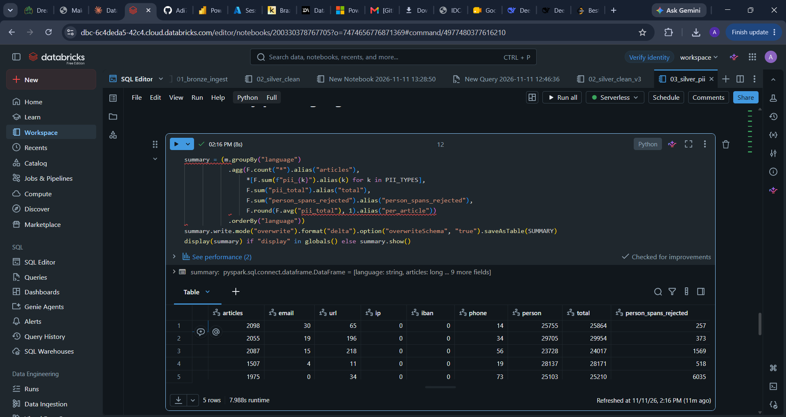
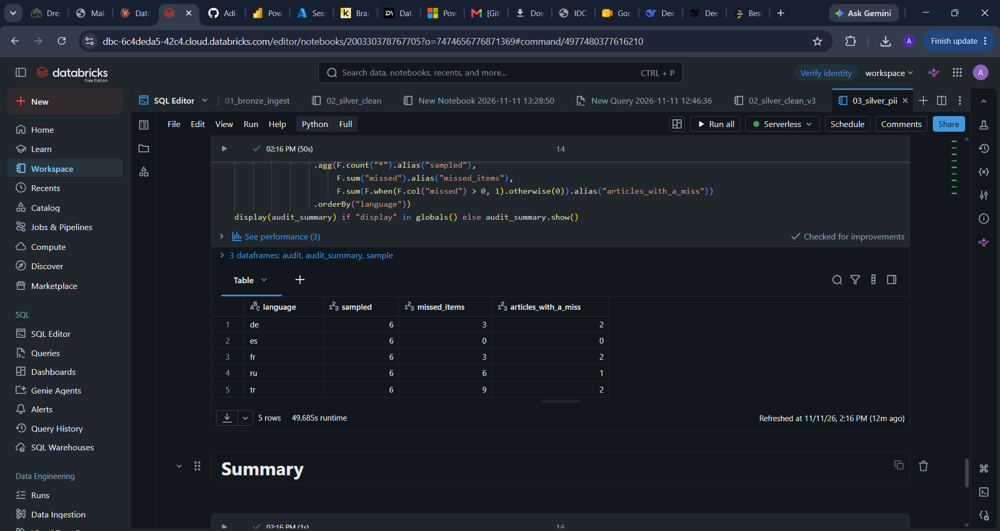
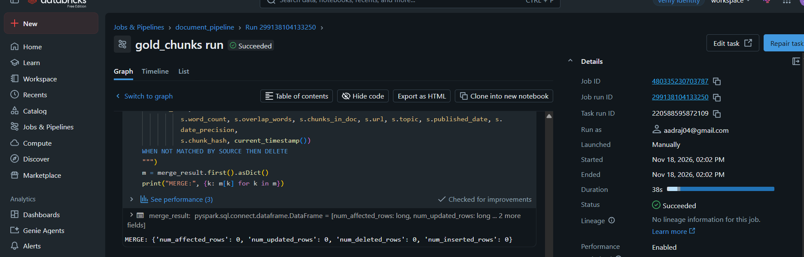
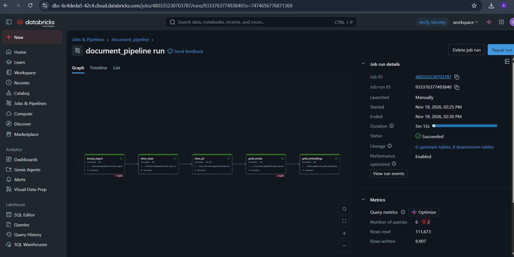
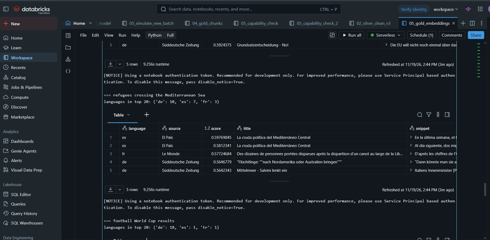

# AI-Ready Document Pipeline on Databricks

A data engineering pipeline that turns raw multilingual news articles into **clean, deduplicated, PII-masked, chunked and embedded** Delta tables, ready for retrieval-augmented generation (RAG). Built on **Databricks** with **PySpark**, **Delta Lake** and **Unity Catalog**.

> 🚧 Status: in progress. Sections marked _TODO_ are filled in as each stage is completed.

---

## Why this project

LLM applications are only as good as the data they retrieve. Raw documents arrive duplicated, inconsistently formatted, in several languages, and containing personal data that must not reach a model or a vector index. This pipeline applies the same data engineering discipline as an analytics lakehouse (layers, quality checks, lineage, incremental processing) to **unstructured text for AI**.

## Architecture

```
MLSUM .jsonl files ──► Unity Catalog Volume (landing zone)
                            │  01_bronze_ingest: raw articles + audit columns
                            ▼
                   docs_bronze.articles   (raw)
                            │  02_silver_clean: clean, exact + near-duplicate removal (MinHash/LSH), language detection
                            ▼
                   docs_silver.articles   (clean)  +  docs_silver.rejected (reasons)
                            │  03_silver_pii: mask emails, URLs, IPs, IBANs, phones (patterns) + names (spaCy NER),
                            │                 residual check (blocking) + LLM audit with ai_mask()
                            ▼
                   docs_silver.articles_masked  +  pii_summary  +  pii_audit
                            │  04_gold_chunks: sentence-aligned chunks with overlap, 5 blocking checks, MERGE
                            ▼
                   docs_gold.chunks       (40,975 chunks)  +  chunk_summary
                            │  05_gold_embeddings: multilingual embeddings (Qwen3, 1,024 dims), only new/changed chunks
                            ▼
                   docs_gold.chunk_vectors ──► Vector Search index docs_gold.chunk_index
                            │  TODO: RAG
                            ▼
                   cross-language search ──► LLM answer with sources

  All five notebooks run as one Databricks Workflow (document_pipeline): weekly, retries, failure email.
```

## Dataset

[MLSUM](https://github.com/recitalAI/MLSUM): real news articles in **5 languages**: German (de), Spanish (es), French (fr), Russian (ru) and Turkish (tr). Each article has a title, full text, summary, topic, URL and date.

This project uses a **deterministic sample of ~10K articles**: up to 2,100 per language from the validation splits, plus all Russian validation and test articles (~1,500). MLSUM is licensed for **non-commercial research use only**, so the raw files are not stored in this repository. See *How to run*.

## Layers

### Bronze: raw ingestion
- Raw `.jsonl` files land in a Unity Catalog Volume: `/Volumes/workspace/docs_bronze/landing/mlsum/<load_date>/`.
- `01_bronze_ingest` reads every file, takes the **language** and **split** from the file name, and keeps a **deterministic sample per language** (ordered by a hash of the URL), so every run picks the same articles.
- Source fields are kept as they are. Each article gets a stable `doc_id` (SHA-256 of its URL) plus audit columns `_ingested_at`, `_source_file`, `_load_date`.
- **Articles ingested: 9,907**

| Language | Articles | Avg. text length (chars) |
|---|---|---|
| German (de) | 2,100 | 3,691 |
| Spanish (es) | 2,100 | 4,507 |
| French (fr) | 2,100 | 3,751 |
| Russian (ru) | 1,507 (all available) | 6,624 |
| Turkish (tr) | 2,100 | 1,620 |

Turkish articles are about 4× shorter than Russian ones, which affects how many chunks each language produces later.



### Silver: clean, deduplicate, detect language
`02_silver_clean` turns 9,907 raw articles into **9,722 clean, unique, language-verified documents**. Every removed article goes to `docs_silver.rejected` with its reason, so nothing disappears silently.

| Step | Method |
|---|---|
| Clean | Strip HTML tags and entities, normalize whitespace, keep paragraph breaks |
| Filter | Reject empty articles and articles under 200 characters |
| Exact duplicates | SHA-256 of the normalized text; keep one per hash |
| Near-duplicates | **MinHash + LSH** on 5-word shingles (32 hashes, 8 bands × 4 rows); estimated Jaccard ≥ 0.8 |
| Language detection | Cyrillic share for Russian; for the others, stopword hits plus letters unique to one language (Turkish ı ğ ş, Spanish ñ ¿ ¡, German ä ß, French è ê œ ù); English scored too, to catch mislabeled articles |
| Dates | Parse `dd/MM/yyyy`; German and Turkish sources only record the month (`00/MM/yyyy`), so those become the 1st of the month with `date_precision = 'month'` |

**Results**

| Language | Bronze | Exact duplicates | Near-duplicates | Silver |
|---|---|---|---|---|
| German (de) | 2,100 | 0 | 2 | 2,098 |
| Spanish (es) | 2,100 | 45 | 0 | 2,055 |
| French (fr) | 2,100 | 13 | 0 | 2,087 |
| Russian (ru) | 1,507 | 0 | 0 | 1,507 |
| Turkish (tr) | 2,100 | 48 | **77** | 1,975 |
| **Total** | **9,907** | **106** | **79** | **9,722** |

- **185 duplicates removed (1.9%).** Turkish had the most (6%), mostly near-duplicates: the same wire story republished with small edits, which exact matching alone would miss.
- **Language detection matches the source label for 99.7% of articles (9,688 of 9,722).** The first version reached 98.0%. A breakdown showed 164 of the 199 misses were Turkish marked `unknown`, because Turkish attaches grammar to word endings and has fewer separate stopwords. Adding letters unique to each language fixed them.
- **The remaining mismatches are a labeling error in the source, not detector errors.** The 34 "Spanish" articles that didn't match are actually **English**: El País also publishes an English edition, and some of those articles ended up in MLSUM's Spanish file. The detector now scores English too, so they're flagged as `detected_language = 'en'`. Downstream steps use the detected language.
- **Dates: 100% parsed** (5,649 to the day, 4,073 to the month). The first version parsed only 58% because of the month-only format.



### Silver: PII masking and verification
`03_silver_pii` masks personal data in all 9,722 articles before any text can reach chunks, embeddings or an LLM. Output: `docs_silver.articles_masked`, with per-article counts of what was masked.

| PII type | Method | Replaced with |
|---|---|---|
| Email, URL, IP, IBAN | Regular expressions | `[EMAIL]` `[URL]` `[IP]` `[IBAN]` |
| Phone numbers | Pattern + at least 9 digits; dates, number ranges, year lists and thousands-separated numbers are excluded; a leading `+` or a nearby "tel / call / llame / телефон" decides ambiguous cases | `[PHONE]` |
| Person names | **spaCy multilingual NER** (`xx_ent_wiki_sm`), run per partition with `mapInPandas`; a Turkish rule adds names after titles (Cumhurbaşkanı, Bakan…); spans not capitalised like a name are rejected and counted | `[PERSON]` |

**Two checks verify the result:**
1. **Residual check (blocking):** the email, URL, IP and IBAN patterns run again on the masked text. Any hit, or a row-count mismatch, fails the job.
2. **Independent audit:** Databricks `ai_mask()` (an LLM) re-reads a sample of masked articles. Anything *it* still masks is PII the pipeline missed. Since `ai_mask` is rate-limited, the audit uses 6 articles per language (first 1,200 characters each).

**Results**

| Language | Articles | Email | URL | Phone | Person | Total | Per article |
|---|---|---|---|---|---|---|---|
| German (de) | 2,098 | 30 | 65 | 14 | 25,755 | 25,864 | 12.3 |
| Spanish (es) | 2,055 | 19 | 196 | 34 | 29,705 | 29,954 | 14.6 |
| French (fr) | 2,087 | 15 | 218 | 56 | 23,728 | 24,017 | 11.5 |
| Russian (ru) | 1,507 | 4 | 11 | 19 | 28,137 | 28,171 | 18.7 |
| Turkish (tr) | 1,975 | 0 | 34 | 73 | 25,103 | 25,210 | 12.8 |
| **Total** | **9,722** | **68** | **524** | **196** | **132,428** | **133,216** | **13.7** |

No IPs or IBANs appeared in the data. **Residual check: 0 hits (passed).**

| Audit (ai_mask) | Sampled | Missed items | Articles with a miss |
|---|---|---|---|
| German | 6 | 3 | 2 |
| Spanish | 6 | 0 | 0 |
| French | 6 | 3 | 2 |
| Russian | 6 | 6 | 1 |
| Turkish | 6 | 9 | 2 |
| **Total** | **30** | **21** | **7** |

- **The first audit measured the wrong thing.** It reported 50 misses in 13 of 30 articles, but most of those were the LLM re-masking our own `[PERSON]` placeholders. The fixed audit subtracts placeholders it overwrote and counts only *new* masks: **21 real misses in 7 articles**.
- **Turkish was over-masked.** The NER model tagged lowercase Turkish words as names. A rule requiring name-like capitalisation (allowing particles like *de*, *van*, *bin*, so "Charles de Gaulle" still passes) cut person masks from 141,180 to **132,428** (8,752 fewer, −6%); every rejected span is counted in `person_spans_rejected`.
- **Phones needed context, not just a pattern.** The first pattern missed numbers followed by a full stop, and treated Spanish `915 123 456` numbers as ordinary thousands. Excluding dates, ranges and year lists, plus a "call/tel" context rule, fixed both without masking prices or statistics.
- **Remaining risk is known and measured:** most misses are names the small NER model doesn't recognise, concentrated in Russian and Turkish. A larger model (or `ai_mask` itself, once it scales) would close this gap.




### Gold: chunks
`04_gold_chunks` splits the 9,722 masked articles into **40,975 chunks**: the unit that gets embedded and handed to the LLM. Each chunk keeps its `doc_id`, position, **language** (the detected one, so the 34 English articles are searchable as English), **source newspaper**, title, URL and date.

| Rule | Value | Why |
|---|---|---|
| Split on | Paragraphs, then sentences | A chunk never cuts a sentence in half |
| Size | ~150 words, hard cap 220 | Fits multilingual embedding models (~512 tokens) and stays on one topic |
| Overlap | Up to 30 words, whole sentences only | A fact on a chunk boundary is still found |
| Very long sentence | Cut on words to fill the chunk | No tiny chunks next to a 200-word sentence |
| Short tail | Merged into the previous chunk | No meaningless 5-word chunks at the end |

**Results**

| Language | Source | Articles | Chunks | Chunks / article | Avg. words |
|---|---|---|---|---|---|
| German (de) | Süddeutsche Zeitung | 2,098 | 7,975 | 3.8 | 151 |
| English (en) | El País (English edition) | 34 | 184 | 5.4 | 156 |
| Spanish (es) | El País | 2,021 | 10,349 | 5.1 | 157 |
| French (fr) | Le Monde | 2,087 | 8,603 | 4.1 | 156 |
| Russian (ru) | Moskovsky Komsomolets | 1,507 | 10,662 | 7.1 | 154 |
| Turkish (tr) | Internet Haber | 1,975 | 3,202 | 1.6 | 129 |
| **Total** | | **9,722** | **40,975** | **4.2** | |

- **Article length drives the index, not article count.** Russian has the fewest articles but the most chunks (7.1 per article), while Turkish articles mostly fit in one or two chunks. Without that adjustment, Russian would dominate search results by volume; Session 6 counts *articles*, not chunks, when it compares coverage between languages.
- **5 blocking checks run before anything is written:** every article has chunks, no empty chunks, none over 220 words, no broken `[PLACEHOLDER]`, and **no text lost**: for every article, the chunks minus their overlap add up to exactly its word count. All 5 passed.
- **Written with MERGE on `chunk_id`** (hash of `doc_id` + position), with a `chunk_hash` per chunk. The first run inserted 40,975 rows; the scheduled Workflow rerun on unchanged data inserted, updated and deleted **0**, so the next step only embeds chunks that are new or changed.



### Orchestration
The five notebooks run as one Databricks Workflow, `document_pipeline`: `bronze_ingest → silver_clean → silver_pii → gold_chunks → gold_embeddings`, weekly on Mondays, with an email on failure. Tasks 1–3 and `gold_embeddings` retry once after 5 minutes (they depend on network steps: a model download, the embedding endpoint, Vector Search); `gold_chunks` has no retry, because its failures come from quality checks and would fail again. A failed check raises an error, so downstream tasks never run on bad data. **First full run: 11 min 29 s** (4 tasks, bronze 8m 10s including serverless start-up). **With embeddings added: 5 min 12 s for all 5 tasks**, because the embedding step only processes what changed. The job definition is in [`workflows/document_pipeline_job.json`](workflows/document_pipeline_job.json).



### Gold: embeddings and vector search
`05_gold_embeddings` turns every chunk (title + text) into a **1,024-number meaning vector** and serves them through a **Databricks Vector Search** index, so a question in one language finds articles in all five.

**Choosing the model: measured, not guessed.** Two capability-check notebooks ([`notebooks/checks/`](notebooks/checks/)) compared the options on Free Edition:

| | `multilingual-e5-small` (open model on our CPU) | **`databricks-qwen3-embedding-0-6b`** (Databricks-hosted) |
|---|---|---|
| English question vs. the same Notre-Dame sentence in de/es/fr/ru/tr and 2 unrelated ones | Lowest on-topic 0.779 vs highest off-topic 0.708 → margin **+0.07** | 0.428 vs 0.120 → margin **+0.31** (4× clearer) |
| Speed | 3.8 chunks/s on the driver; workers couldn't reach Hugging Face, and from a Volume still under 7/s → **1.5+ hours** | **127 chunks/s → about 5 minutes** |
| Runs outside Databricks (for the public site) | Yes | Yes: open weights (Qwen3-Embedding-0.6B), and the site only has to embed the short question |

**Results**

| Step | Result |
|---|---|
| Embedding | **40,975 chunks in 99 s, 0 failures** (`ai_query` with `failOnError => false`, failed rows retried once) |
| Blocking checks | Every chunk has one vector of 1,024 numbers; no NaN; vectors = chunks; labels match chunks |
| Write | MERGE into `docs_gold.chunk_vectors` (Change Data Feed on) |
| Index | Delta Sync index, self-managed embeddings, triggered sync. First build ~22 min; later syncs only process changed rows |

**Incremental by design, and proven by a real bug.** An outdated silver notebook in the Workflow had dropped English detection, relabelling the 184 English chunks as Spanish (168) and Turkish (16). After the fix, the rerun **updated exactly 184 chunks and re-embedded 0**: their text hadn't changed, so only their labels needed syncing. The first version of this notebook didn't sync labels without re-embedding, so the index briefly kept the wrong language filter values; it now does, and a **"labels match chunks"** check fails the job if they ever drift.

**First test searches: what they revealed**

| English question | Languages in the top 20 |
|---|---|
| Brexit negotiations between the UK and the European Union | de 15, fr 3, es 2 |
| refugees crossing the Mediterranean Sea | de 10, es 7, fr 3 |
| football World Cup results | de 18, es 1, tr 1 |

Cross-language search works (German, Spanish and French articles answer an English question), but three problems showed up, and they shape the RAG step:
1. **Language bias:** Russian and Turkish rarely reach a global top 20, because an English question scores higher against Latin-script languages (the capability check showed it too: Russian 0.43 vs ~0.63 for the others). Fix: search **each language separately**, then combine.
2. **Duplicate articles:** one Russian article filled 3 of the top 5 places with different chunks. Fix: **group by article** (`doc_id`) and keep its best chunk.
3. **Closest isn't always relevant:** Russian-only results for the refugee question were about people fleeing *to Russia*, and the top "football" hit was a handball score. Fix: a **minimum relevance score**, so an outlet with no real coverage is reported as "no coverage found".



### RAG search
_TODO_

## Design Decisions
- **Deterministic sampling instead of `sample()`:** reproducible results, so metrics stay comparable between runs.
- **`doc_id` from a hash of the URL:** a stable key that survives re-ingestion and links every chunk back to its source article.
- **Language from the file name, detected again later:** the source label becomes a quality check for the language detector.
- **MinHash + LSH in plain Spark SQL:** finds near-duplicates without comparing all ~49M pairs and without ML libraries that serverless compute may not support.
- **Rejected rows are kept with a reason:** every removal is auditable, not silent.
- **A lightweight, deterministic language detector:** no package installs, fast, and explainable; at larger scale it could be swapped for fastText.
- **`date_precision` instead of guessing a day:** month-only dates stay usable without pretending to be exact.
- **Patterns before NER:** exact patterns run first, so the model never sees (or splits) emails and URLs, and placeholders are never re-tagged as names.
- **Placeholders, not deletion:** `[PERSON]`, `[EMAIL]`… keep sentence structure for chunking and embeddings, and make masking countable.
- **spaCy loaded once per partition with `mapInPandas`:** runs a Python NLP model at Spark scale without loading it per row.
- **A blocking check plus a measured audit:** deterministic PII must be 0 or the job fails; fuzzy PII (names) gets an independent miss rate instead of a guess.
- **`ai_mask` as an auditor, not the masker:** it's rate-limited on this tier, so it checks a sample rather than processing all 9,722 articles.
- **Sentence-aligned chunks with overlap:** retrieval returns complete thoughts, and boundary facts aren't lost.
- **Quality checks before the write, not after:** a bad run never reaches gold.
- **MERGE + `chunk_hash` instead of overwrite:** reruns are idempotent (verified: rerun = 0 rows changed) and the expensive embedding step stays incremental.
- **Detected language on every chunk:** search filters use the language the text is really in, and the newspaper is kept for per-outlet comparisons.
- **Embedding model chosen by a measured test:** cross-language margin and throughput on the real platform, not a leaderboard.
- **Hosted embeddings for the bulk job, open weights for the website:** fast batch embedding in Databricks; the same model can embed questions anywhere.
- **Re-embed by `chunk_hash`, sync labels separately:** text changes cost an embedding call; label fixes cost nothing.
- **Delta Sync index with Change Data Feed:** the index follows the table and only processes changed rows.
- _TODO: add more as built_

## Repository Structure
```
├── data/raw/      # place MLSUM .jsonl files here (not committed; see How to run)
├── notebooks/     # Databricks notebooks (00–05); checks/ = one-off capability tests
├── workflows/     # Databricks Workflow (job) definition
└── docs/          # architecture diagram, screenshots
```

## How to Run
1. Create a [Databricks Free Edition](https://www.databricks.com/learn/free-edition) workspace.
2. Download the MLSUM files `de_val`, `es_val`, `fr_val`, `tu_val`, `ru_val` and `ru_test` (`.jsonl`) from the [MLSUM repository](https://github.com/recitalAI/MLSUM).
3. Run `00_setup`, then upload the files to the landing folder it prints.
4. Run `01_bronze_ingest`, `02_silver_clean`, `03_silver_pii` (installs spaCy and its multilingual model from PyPI/GitHub), `04_gold_chunks` and `05_gold_embeddings` (creates the Vector Search endpoint `docs_vs_endpoint` on its first run), or create the Workflow from `workflows/document_pipeline_job.json` (replace `<your-user>` and `<your-email>`) and run it.

## Author
**Aditya Raj**: [LinkedIn](https://linkedin.com/in/aditya-raj-5a1a6a21b)
