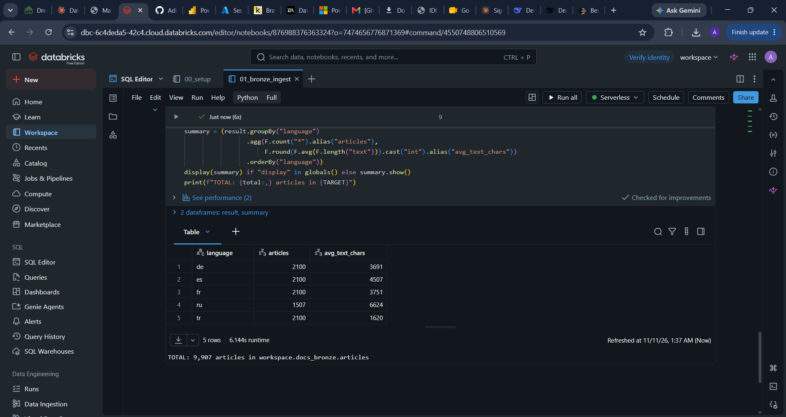
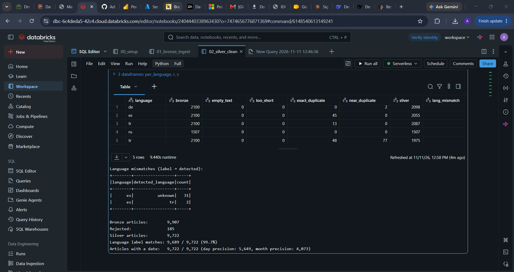

# AI-Ready Document Pipeline on Databricks

A data engineering pipeline that turns raw multilingual news articles into **clean, deduplicated, PII-masked, chunked and embedded** Delta tables, ready for retrieval-augmented generation (RAG). Built on **Databricks** with **PySpark**, **Delta Lake** and **Unity Catalog**.

> 🚧 Status: in progress. Sections marked _TODO_ are filled in as each stage is completed.

---

## Why this project

LLM applications are only as good as the data they retrieve. Raw documents arrive duplicated, inconsistently formatted, in several languages, and containing personal data that must not reach a model or a vector index. This pipeline applies the same data engineering discipline as an analytics lakehouse (layers, quality checks, lineage, incremental processing) to **unstructured text for AI**.

## Architecture

```
MLSUM .jsonl files ──► Unity Catalog Volume (landing zone)
                            │  01_bronze_ingest: raw articles + audit columns
                            ▼
                   docs_bronze.articles   (raw)
                            │  02_silver_clean: clean, exact + near-duplicate removal (MinHash/LSH), language detection
                            ▼
                   docs_silver.articles   (clean)  +  docs_silver.rejected (reasons)
                            │  TODO: PII masking, quality checks
                            ▼
                   docs_gold.*            (chunks + embeddings) ──► vector search ──► RAG
```

## Dataset

[MLSUM](https://github.com/recitalAI/MLSUM): real news articles in **5 languages**: German (de), Spanish (es), French (fr), Russian (ru) and Turkish (tr). Each article has a title, full text, summary, topic, URL and date.

This project uses a **deterministic sample of ~10K articles**: up to 2,100 per language from the validation splits, plus all Russian validation and test articles (~1,500). MLSUM is licensed for **non-commercial research use only**, so the raw files are not stored in this repository. See *How to run*.

## Layers

### Bronze: raw ingestion
- Raw `.jsonl` files land in a Unity Catalog Volume: `/Volumes/workspace/docs_bronze/landing/mlsum/<load_date>/`.
- `01_bronze_ingest` reads every file, takes the **language** and **split** from the file name, and keeps a **deterministic sample per language** (ordered by a hash of the URL), so every run picks the same articles.
- Source fields are kept as they are. Each article gets a stable `doc_id` (SHA-256 of its URL) plus audit columns `_ingested_at`, `_source_file`, `_load_date`.
- **Articles ingested: 9,907**

| Language | Articles | Avg. text length (chars) |
|---|---|---|
| German (de) | 2,100 | 3,691 |
| Spanish (es) | 2,100 | 4,507 |
| French (fr) | 2,100 | 3,751 |
| Russian (ru) | 1,507 (all available) | 6,624 |
| Turkish (tr) | 2,100 | 1,620 |

Turkish articles are about 4× shorter than Russian ones, which affects how many chunks each language produces later.



### Silver: clean, deduplicate, detect language
`02_silver_clean` turns 9,907 raw articles into **9,722 clean, unique, language-verified documents**. Every removed article goes to `docs_silver.rejected` with its reason, so nothing disappears silently.

| Step | Method |
|---|---|
| Clean | Strip HTML tags and entities, normalize whitespace, keep paragraph breaks |
| Filter | Reject empty articles and articles under 200 characters |
| Exact duplicates | SHA-256 of the normalized text; keep one per hash |
| Near-duplicates | **MinHash + LSH** on 5-word shingles (32 hashes, 8 bands × 4 rows); estimated Jaccard ≥ 0.8 |
| Language detection | Cyrillic share for Russian; for the others, stopword hits plus letters unique to one language (Turkish ı ğ ş, Spanish ñ ¿ ¡, German ä ß, French è ê œ ù) |
| Dates | Parse `dd/MM/yyyy`; German and Turkish sources only record the month (`00/MM/yyyy`), so those become the 1st of the month with `date_precision = 'month'` |

**Results**

| Language | Bronze | Exact duplicates | Near-duplicates | Silver |
|---|---|---|---|---|
| German (de) | 2,100 | 0 | 2 | 2,098 |
| Spanish (es) | 2,100 | 45 | 0 | 2,055 |
| French (fr) | 2,100 | 13 | 0 | 2,087 |
| Russian (ru) | 1,507 | 0 | 0 | 1,507 |
| Turkish (tr) | 2,100 | 48 | **77** | 1,975 |
| **Total** | **9,907** | **106** | **79** | **9,722** |

- **185 duplicates removed (1.9%).** Turkish had the most (6%), mostly near-duplicates: the same wire story republished with small edits, which exact matching alone would miss.
- **Language detection matches the source label for 99.7% of articles.** The first version reached 98.0%. A breakdown showed 164 of the 199 misses were Turkish marked `unknown`, because Turkish attaches grammar to word endings and has fewer separate stopwords. Adding letters unique to each language fixed them.
- **Dates: 100% parsed** (5,649 to the day, 4,073 to the month). The first version parsed only 58% because of the month-only format.



### PII masking and quality checks
_TODO_

### Gold: chunks and embeddings
_TODO_

## Design Decisions
- **Deterministic sampling instead of `sample()`:** reproducible results, so metrics stay comparable between runs.
- **`doc_id` from a hash of the URL:** a stable key that survives re-ingestion and links every chunk back to its source article.
- **Language from the file name, detected again later:** the source label becomes a quality check for the language detector.
- **MinHash + LSH in plain Spark SQL:** finds near-duplicates without comparing all ~49M pairs and without ML libraries that serverless compute may not support.
- **Rejected rows are kept with a reason:** every removal is auditable, not silent.
- **A lightweight, deterministic language detector:** no package installs, fast, and explainable; at larger scale it could be swapped for fastText.
- **`date_precision` instead of guessing a day:** month-only dates stay usable without pretending to be exact.
- _TODO: add more as built_

## Repository Structure
```
├── data/raw/      # place MLSUM .jsonl files here (not committed; see How to run)
├── notebooks/     # Databricks notebooks
└── docs/          # architecture diagram, screenshots
```

## How to Run
1. Create a [Databricks Free Edition](https://www.databricks.com/learn/free-edition) workspace.
2. Download the MLSUM files `de_val`, `es_val`, `fr_val`, `tu_val`, `ru_val` and `ru_test` (`.jsonl`) from the [MLSUM repository](https://github.com/recitalAI/MLSUM).
3. Run `00_setup`, then upload the files to the landing folder it prints.
4. Run `01_bronze_ingest`, then `02_silver_clean`.

## Author
**Aditya Raj**: [LinkedIn](https://linkedin.com/in/aditya-raj-5a1a6a21b)
